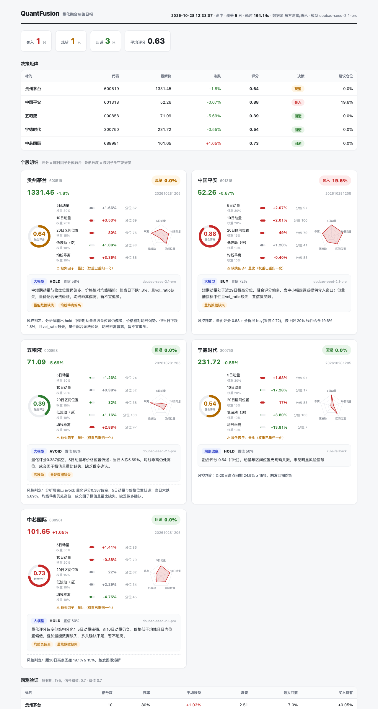

# QuantFusion 量化融合引擎

一个"离线统计 + 在线融合 + 金融大模型门控 + 风控否决"四层结构的 A 股量化研究系统。
零第三方依赖（纯 Python 标准库），数据源为东方财富公开行情 API，存储用 SQLite。



## 架构与需求的对应关系

```
                        ┌─────────────────────────────────────┐
   需求1 离线层          │  cron 定时任务 → offline.py          │
   （批量/定时）         │  批量拉60日K线 → 8因子逐日统计 → 落库 │
                        └──────────────┬──────────────────────┘
                                       │ SQLite: kline_daily / factor_daily
                        ┌──────────────▼──────────────────────┐
   需求2/3 在线层        │  online.py                          │
   （实时+历史融合）     │  实时API拿今日快照（盘中量比按时段折算）│
                        │  + 库中近29日历史统计 → 百分位融合    │
                        │  → 0~1 综合评分（约1~2秒出结果）      │
                        └──────────────┬──────────────────────┘
                        ┌──────────────▼──────────────────────┐
   需求4 大模型层        │  llm_analyst.py                     │
   （语义门控）          │  OpenAI兼容协议，可接火山方舟/        │
                        │  OpenRouter(Ling-3.0-flash-Fin)/     │
                        │  DeepSeek/GLM；无Key自动降级规则分析师 │
                        └──────────────┬──────────────────────┘
                        ┌──────────────▼──────────────────────┐
   风控层（一票否决）    │  risk.py：仓位上限/低置信降级/        │
                        │  振幅熔断/回撤熔断 → BUY/WAIT/AVOID   │
                        └─────────────────────────────────────┘
```

三种计算模式全部实现：
1. **纯离线**：`python3 main.py offline`（定时任务或手动批量，统计结果落库）
2. **纯在线**：`fetch_realtime` 直接拿 + 直接算（用于无历史数据时的兜底）
3. **大数据在线**：今日实时统计 + 历史预计算统计融合（默认路径，1~2 秒出全池结果）

## 快速开始

项目使用 Python 3.13（最低兼容版本为 Python 3.10），无需安装第三方 Python 包。可用 [uv](https://docs.astral.sh/uv/) 安装并运行：

```bash
cd quantfusion
uv python install 3.13
uv run --python 3.13 main.py test      # 16 个单元测试
uv run --python 3.13 main.py all       # 离线回填 → 回测 → 在线决策（首次部署）
uv run --python 3.13 main.py online    # 日常盘中运行（前提：offline 已跑过，自动产出 HTML 日报）
uv run --python 3.13 main.py report    # 用最新一份在线报告重新渲染 HTML 决策日报
uv run --python 3.13 main.py backtest  # 重新回测
```

项目已在 Python 3.10、3.11、3.12 和 3.13 上验证；Python 3.9 及更早版本不兼容。

输出：
- `reports/online_*.json` —— 每只股票的价格/评分/因子分位/大模型意见/风控决策
- `reports/daily_*.html` —— **可视化决策日报**（评分环/因子条形图/雷达图/大模型理由/风控判定/回测摘要，单文件可直接分享）
- `reports/backtest_*.md` —— 回测报告（胜率/平均收益/年化夏普/最大回撤/对比买入持有）

## 定时任务配置（生产示例）

```bash
# crontab -e（北京时间）
# 16:05 收盘后离线回填当日数据并重算因子（东财日K在15:05后即为确认数据）
5 16 * * 1-5 cd /path/to/quantfusion && /usr/bin/python3.13 main.py offline >> logs/offline.log 2>&1
# 09:35 / 10:35 / 13:35 / 14:35 盘中在线决策
35 9,10,13,14 * * 1-5 cd /path/to/quantfusion && /usr/bin/python3.13 main.py online >> logs/online.log 2>&1
```

## 接入真实金融大模型（.env 配置）

系统按 OpenAI 兼容协议调用。在项目根目录创建 `.env`（已被 .gitignore 排除，密钥不会入库）：

```bash
QF_LLM_BASE_URL=https://ark.cn-beijing.volces.com/api/plan/v3   # 或 OpenRouter: https://openrouter.ai/api/v1
QF_LLM_API_KEY=你的Key
QF_LLM_MODEL=你的模型ID   # 如 doubao-seed-2.1-pro / OpenRouter 上的 inclusionai/ling-3.0-flash-fin:free
```

也可用环境变量代替 `.env`（`export QF_LLM_*`）。

- 配好后 `[rule]` 会变成 `[llm]`，模型按"语义门控"方式对因子快照做逻辑匹配并输出结构化 JSON（signal/confidence/selected_factors/rationale/risk_flags）。
- **不配置也能跑**：自动降级为确定性规则分析师，输出结构完全一致——这是保证全链路可用的兜底设计。
- 调用失败或 JSON 校验不过也会自动降级，并在报告 `llm_error` 字段记录原因。

## 数据源与容灾

实时行情与日 K 线均设计了多级通道，单家限流不影响全链路：

| 通道 | 端点 | 说明 |
|---|---|---|
| ① 东财批量 | `push2.eastmoney.com/api/qt/ulist.np/get` | 一次请求覆盖全股票池，默认通道 |
| ② 东财单票 | `push2.eastmoney.com/api/qt/stock/get` | 批量缺票时逐票补 |
| ③ 腾讯兜底 | `qt.gtimg.cn`（实时）/ `web.ifzq.gtimg.cn`（K线） | 东财限流时自动接管；腾讯K线无成交额（amount=None） |

请求带 1s→2s→4s→8s 指数退避重试。若两家同时限流，等待几分钟即可恢复。
注意：doubao-seed-2.1-pro 是思考型模型，全池 5 只票在线决策约 2-3 分钟（LLM 层占大头）。

## 因子与评分（近29日分位融合）

| 因子 | 含义 | 评分方向 |
|---|---|---|
| mom5 / mom10 | 5/10日动量 | 分位越高越好 |
| vol20 | 20日收益率波动 | 分位越低越好 |
| vol_ratio | 量比（盘中按时段折算全天） | 越高越好 |
| amplitude | 日振幅 | 不计分，作熔断依据 |
| rsi14 | Cutler RSI | 观测项 |
| close_pos | 收盘在20日区间位置 | 越高越好 |
| ma_bias | (MA5-MA20)/MA20 | 越高越好 |

综合评分 = 各因子"今日值在近29日历史分布中的百分位"加权平均（缺因子自动降权重归一化）。
评分 ≥0.70 偏多、≤0.30 偏弱，最终买卖由大模型意见 + 风控共同决定。

## 扩展方向

- 股票池：改 `config.py` 的 `universe`（secid 规则：沪 `1.xxxxxx`，深 `0.xxxxxx`）
- 加因子：在 `factors.py` 增加列 + `SCORE_WEIGHTS` 加权重 + `store.py` 表结构加列
- 历史统计的持久化已支持增量：`offline` 幂等，重复跑不产生脏数据
- 回测样本目前约 60 个交易日，建议把 `history_days` 提到 250+ 再看统计显著性

## 已验证项

- 16/16 单元测试通过（因子符号、RSI 极值、融合高低分位、LLM 兜底、四条风控规则、存储幂等）
- 端到端实盘数据联调：5 只股票 offline(69条K线/48条因子) → 回测 → 在线 1.3s 出全池决策
- 风控正确触发：宁德时代/中芯国际因"距20日高点回撤≥15%"被熔断 AVOID

> **免责声明**：以上内容基于公开数据和量化分析，仅供参考，不构成投资建议。市场有风险，投资需谨慎。任何投资决策应结合个人风险承受能力、资金状况和投资目标独立判断，必要时咨询持牌专业机构。过往表现不预示未来收益。
